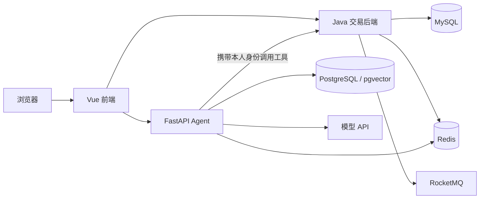

# 邻里惠 · LocalPerks

**一个带智能客服的本地生活优惠平台。**

用户可以找店、看探店笔记、领优惠券，也可以直接问助手：“附近两个人吃饭，人均 80 元，有什么合适的店？”助手会查询商家和优惠券，按预算、距离和使用条件筛选，再解释推荐理由。查本人订单和取消订单也放在同一套对话里，涉及交易时仍需要本人确认。

项目主要练习两条链路：一条是 Redis、RocketMQ、MySQL 配合的优惠券交易；另一条是可以调用业务接口、记住消费偏好、支持异步任务的客服助手。

> 

## 目录

- [能做什么](#能做什么)
- [系统怎么分工](#系统怎么分工)
- [几个关键流程](#几个关键流程)
- [项目结构](#项目结构)
- [本地运行](#本地运行)
- [第一次体验](#第一次体验)
- [配置说明](#配置说明)
- [接口速查](#接口速查)
- [测试与验证](#测试与验证)
- [常见问题](#常见问题)

## 能做什么

### 本地生活与优惠交易

| 功能 | 具体内容 |
|---|---|
| 商家查询 | 按名称或分类找店，结合 Redis GEO 查询附近商家，查看地址、人均价格和营业时间 |
| 探店社区 | 发布笔记、热门笔记、点赞、关注、关注动态、共同关注、每日签到 |
| 优惠券 | 查看普通优惠券和秒杀券，展示售价、面值、库存及使用规则；金额接口以分为单位 |
| 秒杀下单 | 校验活动时间与历史订单，Lua 原子检查库存和一人一券资格，收到 Broker 确认后返回受理结果 |
| 本人券包 | 查看自己的订单和券，区分排队、处理中、待支付、取消等状态 |
| 订单处理 | 模拟支付、本人取消、超时关闭与库存释放；使用状态条件更新和唯一约束处理重复请求 |
| 热点缓存 | 店铺详情使用 Caffeine 和 Redis 两级缓存，配合布隆过滤器、空值缓存、消息通知清理 |
| 访问保护 | 按全局、IP、用户限制部分接口的访问频率；私有订单继续由 Java 后端校验归属 |

### 智能客服与消费助手

| 功能 | 具体内容 |
|---|---|
| 业务查询 | 查商家、优惠券、本人订单和券包；明确的简单查询可以直接调用工具 |
| 消费推荐 | 询问或继承人数、预算、位置、时间等条件，查实时业务数据后筛选、计算和排序 |
| 规则问答 | BM25、向量检索、RRF 融合、模型重排；回答带来源，缺少证据时保留不确定性 |
| 多轮对话 | 可以继续说“预算改成 80”“第二家有什么券”，沿用会话里已经明确的条件 |
| 我的偏好 | 保存、修改、清除默认预算、距离、分类偏好和回复风格；本次要求优先 |
| 异步任务 | 先返回任务编号，后台执行，WebSocket 通知进度；断线后可以查询任务和补取事件 |
| 多实例调度 | PostgreSQL 共享队列按受理顺序处理同一会话，其他会话并行；租约支持实例退出后的接管 |
| 模型调用控制 | 异步 HTTP、连接池、Redis 全局 RPM/TPM/并发控制、输出长度限制、执行超时与排队时限 |
| 交易确认 | 抢券、取消订单先展示摘要，再由用户确认；超时先核对结果，不自动重复提交写请求 |
| 工具审计 | 参数校验、身份检查、工具风险检查和调用记录；模型不能自行指定其他用户身份 |


## 系统怎么分工

| 部分 | 技术 | 负责什么 |
|---|---|---|
| 交易后端 | Java 8 、JDK 17 、Spring Boot、MyBatis-Plus | 登录身份、商家与笔记、优惠券、库存、订单和资源归属 |
| 缓存与消息 | Redis、Lua、Caffeine、RocketMQ | 原子预留、热点缓存、异步订单、超时消息与重试 |
| Agent 服务 | Python 3.12、FastAPI、Tool Calling | 理解需求、编排工具、检索知识、生成解释 |
| Agent 状态 | PostgreSQL、Redis | 任务、事件、检查点、共享队列、用户偏好和短期会话 |
| 知识检索 | PostgreSQL/pgvector、BM25、RRF、Rerank | 保存和检索使用规则及 FAQ |
| 前端 | Vue 3、TypeScript、Pinia、Vite、Element Plus | 业务页面、助手对话、进度通知、偏好设置和操作确认 |



Java 始终负责业务事实和交易结果。Agent 不直接修改库存或订单，也不绕过登录与本人确认。模型负责理解问题和组织表达，金额、用券条件和推荐排序由程序计算。

## 几个关键流程

### 1. 秒杀下单

```text
请求限流与身份校验
  → 查询活动时间、本人历史订单
  → Redis Lua 校验库存和资格、建立预留
  → RocketMQ 发送并等待 Broker 确认
  → 返回订单编号与受理状态
  → 消费者执行 MySQL 库存条件扣减、唯一约束下单
  → 更新可查询的订单结果
```

前置查询和消息发送使用有界批处理，减少高峰时逐条查询、逐条发送的等待。查询连接池与订单写入连接池分开，防止前置查询占满写入连接。

消息发送超时，保留原订单编号和预留状态，再核对结果，避免把已经发出的订单误回补。订单创建时同时写入关单任务，提交后发送延迟消息；到期检查与重试负责兜底。

### 2. 一次推荐回答

```text
“附近两人吃饭，人均80元”
  → 读取本人的默认偏好和当前会话
  → 补问缺少的位置、日期或具体时间
  → 查询商家和优惠券
  → 程序过滤预算、距离、排除分类和用券条件
  → 计算单张券的估算实付并排序
  → 模型根据已核验的事实解释结果
```

本次要求覆盖会话条件，会话条件覆盖长期默认。模型不能把明确的“80 元预算”改成其他数值；回答中的商家、金额和确定性业务结论需要对应事实来源。

### 3. 多人同时提问

登录用户提交问题后，任务、请求幂等记录和共享队列一起写入 PostgreSQL，再返回 `202`。多个执行实例领取任务，同一会话的后续问题等待前一轮结束，其他会话可以并行。

执行前会重新验证 Java 登录身份。短期凭据经认证加密后放入 Redis，数据库只保存随机引用；凭据过期需要用户重新登录。模型配额由 Redis 统一计算，增加实例不会凭空增加供应商额度。

每个实例使用一个数据库监听器接收事件通知，避免每条 WebSocket 都频繁轮询数据库。事件仍持久化，断线后按 `seq` 补查，通知丢失也可以通过状态查询恢复。

### 4. 抢券与取消订单

助手先展示券、金额或订单等确认信息，用户点击确认后才执行。查询本人订单时继续校验身份；写请求超时后进入核对流程，不直接再次提交。

## 项目结构

```text
localperks/
├─ src/main/java/com/hmdp/   Java 后端
├─ src/main/resources/      配置、Mapper、Lua、数据库初始化
├─ src/test/                Java 测试
├─ frontend/                Vue 前端及浏览器测试
├─ agent-service/           Python Agent 与自身单测
├─ tests/                   跨服务、调度、持久化、检索和压力测试
├─ scripts/                 本地启动、验证和清理脚本
├─ docker/                  Redis、RocketMQ 配置
├─ docs/                    API、缓存、Agent 与验证说明
└─ docker-compose.yml       本地依赖服务
```

Java 包名与部分 `HMDP_*` 配置保留了学习项目的历史命名，项目名称、界面与公开仓库统一使用 LocalPerks。

## 本地运行

### 环境要求

- JDK 17、Maven 3.8+；编译目标为 Java 8。
- Node.js 20+、npm。
- Python 3.12+。
- Docker Desktop 的 Linux 容器模式，Compose 2.24.4+。
- 下方启动脚本使用 PowerShell；Linux/macOS 可以手动设置相同环境变量并启动各服务。

### 1. 克隆并准备配置

```powershell
git clone https://github.com/w0NDfu/localperks.git
cd localperks
Copy-Item .env.example .env
```

编辑根目录 `.env`，为 `HMDP_DB_PASSWORD` 设置一个自己的本地数据库密码。已经有数据卷时不要随意改密码。真实 `.env`、模型密钥、数据库文件和上传图片都不会进入 Git。

### 2. 准备 Agent

```powershell
cd agent-service
python -m venv .venv
.\.venv\Scripts\python.exe -m pip install -e '.[test]'
Copy-Item .env.example .env
.\.venv\Scripts\python.exe -m api.bootstrap
cd ..
```

`api.bootstrap` 创建本地 PostgreSQL 配置和共享加密密钥；已有数据库、模型凭据会保留。然后编辑 `agent-service/.env`，填写可用的模型接口和密钥。默认配置见下文。

### 3. 启动依赖

```powershell
docker compose --profile agent up -d
docker compose --profile agent ps
```

这会启动 MySQL、Redis、RocketMQ 和带 pgvector 的 PostgreSQL。MySQL 从 `src/main/resources/db/dianping.sql` 初始化；Redis 的初始化脚本只在新数据上补充演示配置，不在重启时重置抢券记录。

### 4. 分别启动三个应用

终端一，在仓库根目录启动 Java：

```powershell
.\scripts\start-backend.ps1
```

终端二，启动 Agent：

```powershell
cd agent-service
.\.venv\Scripts\python.exe main.py
```

终端三，启动前端：

```powershell
cd frontend
npm ci
npm run dev
```

| 地址 | 用途 |
|---|---|
| `http://localhost:5173` | 前端 |
| `http://127.0.0.1:8081` | Java API |
| `http://127.0.0.1:8090/docs` | Agent Swagger |
| `127.0.0.1:3307` | MySQL |
| `127.0.0.1:6379` | Redis |
| `127.0.0.1:5433` | PostgreSQL |
| `127.0.0.1:9876` | RocketMQ NameServer |

Vite 将 `/api` 代理到 Java，将 `/agent-api`（包含 WebSocket）代理到 Agent。

### 5. 初始化知识库（可选）

Java、PostgreSQL 和模型配置就绪后，在 `agent-service` 目录执行：

```powershell
.\.venv\Scripts\python.exe -m rag.cli --repo ..
```

它会导入项目规则文档及可查询商家的规则说明，并调用配置的 Embedding API。价格、实时库存和本人订单不依赖旧文档回答，仍须查询 Java。变更向量模型或维度时，需要重新生成对应索引数据。

### 6. 开发结束

停止三个应用进程后，在仓库根目录执行：

```powershell
docker compose --profile agent --profile dashboard stop
```

`stop` 保留容器和数据卷；日常开发不需要 `down -v`。

## 第一次体验

1. 打开首页，浏览商家、优惠券和探店笔记。
2. 用自己的本地测试手机号获取验证码并登录。当前验证码保存在 Redis，开发时可在后端调试日志中查看；没有接入短信服务。
3. 在优惠券页面尝试抢券，到“我的券包”查询状态。可以模拟支付或取消订单，不会发生真实扣款。
4. 打开 AI 助手，先试“查询店铺 4 的优惠券”，再试“推荐附近两个人吃饭、人均 80 元的店”。商家ID请以自己数据库的数据为准。
5. 当助手追问时补充当前位置和计划用餐时间，再问“第二家有什么券”。测试位置应与演示商家所在城市一致。
6. 展开“我的偏好”，保存预算、分类或回复风格，开启新对话观察默认条件；本次提问可以覆盖默认。
7. 让助手帮忙抢券或取消本人订单，核对确认卡片后再提交，也可以展开调用记录查看实际查询。

## 配置说明

### Java 与前端

| 配置 | 说明 |
|---|---|
| `HMDP_DB_URL` | MySQL JDBC 地址；默认本地 3307 的 `dianping` |
| `HMDP_DB_USERNAME` / `HMDP_DB_PASSWORD` | 根目录 `.env` 中的本地数据库账号和密码 |
| `HMDP_IMAGE_UPLOAD_DIR` | 图片上传目录；默认当前仓库的 `frontend/public/imgs` |
| `VITE_API_PROXY_TARGET` | Java 代理目标，默认 `http://localhost:8081` |
| `VITE_AGENT_PROXY_TARGET` | Agent 代理目标，默认 `http://127.0.0.1:8090` |
| `VITE_IMAGE_BASE_URL` | 图片地址前缀；开发环境默认 `/imgs` |

### Agent

| 配置 | 默认值 / 用途 |
|---|---|
| `OPENAI_BASE_URL` / `OPENAI_API_KEY` | 自行配置的 OpenAI 兼容模型服务 |
| `OPENAI_MODEL` | 示例配置为 `gpt-6-luna`；可换成支持工具调用和结构化输出的模型 |
| `OPENAI_REASONING_EFFORT` | 当前示例使用 `none` |
| `EMBEDDING_MODEL` / `EMBEDDING_DIMENSIONS` | `text-embedding-3-small` / 1536 |
| `RERANK_MODEL` | `BAAI/bge-reranker-v2-m3`，需接口支持重排协议 |
| `LOCALPERKS_BASE_URL` | Java 地址，默认 `http://127.0.0.1:8081` |
| `REDIS_URL` | 会话、配额和短期加密凭据的 Redis 地址 |
| `AGENT_STATE_DSN` | 可靠任务库，未单独配置时使用 `PGVECTOR_DSN` |
| `AGENT_CREDENTIAL_KEY` | 所有执行实例共享的加密密钥，bootstrap 生成，不能公开 |
| `AGENT_WORKERS` | 每实例异步执行者数量，默认 16 |
| `AGENT_GLOBAL_WORKFLOWS` | 异步工作流全局预算，默认 256 |
| `AGENT_QUEUE_CAPACITY` / `AGENT_PER_USER_PENDING` | 全局待处理预算 10000 / 每用户 32 |
| `AGENT_QUEUE_WAIT_SECONDS` | 默认最多排队 300 秒 |
| `AGENT_MODEL_RPM` / `AGENT_MODEL_TPM` | 应用请求/Token 预算，须按实际账户额度设置 |
| `AGENT_MODEL_CONCURRENCY` | 多实例共享的模型调用并发预算，默认 128 |
| `AGENT_MODEL_OUTPUT_TOKENS` | 单次输出上限，默认 2048 |

多个实例要连接同一个状态库、Redis，使用一致的共享配置和加密密钥。

## 接口速查

以下是服务端路径。浏览器访问时，Java 接口前加 `/api`，Agent 接口前加 `/agent-api`。

| 方法与路径 | 用途 |
|---|---|
| `POST /user/code?phone=...` | 获取本地登录验证码 |
| `POST /user/login` | 登录 |
| `GET /shop/of/name` / `GET /shop/of/type` | 查商家 |
| `GET /voucher/market` | 优惠券列表 |
| `POST /voucher-order/seckill/{id}` | 抢券 |
| `GET /voucher-order/status/{id}` | 查本人订单状态 |
| `POST /voucher-order/mock-pay/{id}/{success}` | 本地模拟支付 |
| `POST /voucher-order/cancel/{id}` | 取消本人未支付订单 |
| `POST /agent/tasks` | 提交异步问题，携带唯一 `request_id` |
| `GET /agent/tasks/{id}` / `GET /agent/tasks/{id}/events` | 查询任务和补取事件 |
| `WS /agent/tasks/{id}/ws` | 首帧认证后接收事件，支持 `after` 游标 |
| `GET /agent/preferences` | 查看本人的偏好 |
| `PUT /agent/preferences` | 带版本号修改偏好 |
| `DELETE /agent/preferences?revision=...` | 清除偏好并推进版本 |
| `POST /agent/actions/prepare` | 准备操作摘要 |
| `POST /agent/actions/{id}/confirm` | 本人确认后执行 |
| `POST /agent/actions/{id}/reconcile` | 核对不确定的结果 |

完整参数见 [API 文档](docs/API.md) 和启动后的 Agent Swagger。

## 测试与验证

### 本次公开版本检查（2026-11-17）

| 检查 | 结果 |
|---|---|
| Java 构建 | `mvn -o -DskipTests package` 通过 |
| Java 订单与消息专项 | 41 项通过，使用 Mockito 等测试替身 |
| 前端 | ESLint、27 项单测、类型检查和生产构建通过 |
| 助手页面 | Edge 浏览器 6 项测试通过，API 使用替身 |
| Agent 隔离回归 | 164 项通过、2 项跳过；使用真实隔离 PostgreSQL/Redis，模型与业务 HTTP 使用替身 |

跳过项为需预先导入知识库的 pgvector 检索，以及需显式开启的 2000 用户负载。本次发布检查没有请求真实模型、重新压测交易吞吐或进行公网部署验收。前端构建仍有第三方注释和包体积提示，不影响构建通过。

### 常用检查

```powershell
# Java：需要相应的本地依赖与数据库配置
.\scripts\maven.ps1 test
# 仅构建
mvn -DskipTests package

# 前端，在 frontend 目录执行
npm run lint
npm run test
npm run build
npm run e2e
```

## 常见问题

**没有模型密钥，能不能看页面和用业务功能？**

可以。先运行 Java 和前端，商家、笔记、券包等业务页面可以单独使用。开放式问答、模型解释和向量生成需要配置相应模型服务；明确的简单业务查询可以走工具直达路径。

**为什么只能看到很少的附近商家？**

附近查询依赖有效经纬度和 Redis GEO 数据。演示数据不是全国商家库，当前位置也应与数据所在城市一致。

**模型重排是不是一定能提高所有问题的准确率？**

不是。它改善的是候选排序，缺少业务事实时仍然不能得出确定答案；同时会增加接口耗时。离线检索指标和最终回答正确率需要分别评估。

**为什么任务恢复后还要查一次库存和优惠券？**

这些数据可能已经变化。静态解析可以利用检查点，实时业务数据仍要重新查询。服务恢复也不能绕过用户身份和交易确认。


## 进一步阅读

- [完整 API](docs/API.md)
- [店铺缓存](docs/CACHE_ARCHITECTURE.md)
- [Agent 调度、配额与偏好](docs/AGENT_SHARED_CONCURRENCY.md)
- [客服规则知识源](docs/AGENT_BUSINESS_KNOWLEDGE.md)
- [测试方式与边界](docs/TESTING.md)
- [本地依赖与问题排查](docs/DOCKER_LOCAL_DEV.md)

